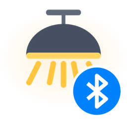

# iLink Light

[![HACS Custom][hacs-badge]][hacs]
[![GitHub release][release-badge]][releases]
[![License][license-badge]](LICENSE)

Home Assistant integration for the cheap Bluetooth ceiling and table lights that are controlled with the
**iLink** app (the ones sold on AliExpress and Amazon under a dozen different names). Everything runs locally
over Bluetooth, no cloud and no app needed.

This is a fork of [donandren/ilink_light](https://github.com/donandren/ilink_light). The original worked for
turning the light on and off, but colours, effects and state reporting never really worked on my lamp, so I
went through the protocol with a real fixture and rewrote the integration around how the lamp actually behaves.

[![Open your Home Assistant instance and open this repository in HACS.][my-badge]][my-link]

## Is my light supported?

Probably, if it's controlled by the iLink app. In Home Assistant's Bluetooth view (or any BLE scanner app) these
lights show up as `ilink app` and advertise the service `0000a032-0000-1000-8000-00805f9b34fb`. They're built
on a JieLi chip and all seem to speak the same protocol.

Tested on a ceiling light with an IR remote (firmware 2.19). If you have a different model, I'd like to hear
whether it works. Open an issue either way.

## Installation

### HACS

1. Click the button above, or in HACS go to the three-dot menu, *Custom repositories*, and add
   `https://github.com/DevilRange/ilink_light` as an *Integration*.
2. Download **iLink Light** and restart Home Assistant.

### Manual

Copy `custom_components/ilink_light` from this repository into your `config/custom_components/` folder and
restart Home Assistant.

## Setup

Lamps are discovered automatically. Once the lamp is powered, a notification shows up under
*Settings → Devices & services*. You can also add it yourself with *Add integration → iLink Light*.

Close the iLink app on your phone first. The lamp only accepts one Bluetooth connection, and this integration
keeps it.

Coming from donandren's version or one of its forks? Install this over it and restart. Your existing entity,
its history and its area are kept, and the old config entry is migrated automatically. (That only works for
entries with a single lamp. If you had several lamps in one entry, remove it and add them again.)

## What you get

One light entity per lamp with:

- on/off and brightness
- colour temperature from 3000 K to 6000 K (the continuous control, not five fixed steps)
- RGB colour
- the remote's modes and the lamp's built-in scenes as effects
- state read back from the lamp every few seconds, so changes made with the IR remote show up in Home Assistant
- the Activity log shows what changed, not just on and off: "mode White: warm", "brightness down to 40 %",
  "colder (5000 K)", "scene Rainbow", with "(remote)" when it wasn't done from Home Assistant
- the entity goes *unavailable* when the lamp loses power and comes back by itself when power returns

### Effects

The effect list starts with the white modes in the same order as the remote's MODE button, followed by the
built-in scenes:

| Effect | Remote | What it is |
|---|---|---|
| White: cold | MODE (1st) | 6000 K. This is also what the lamp powers up in. |
| White: warm | MODE (2nd) | 3000 K |
| White: sunlight (max) | MODE (3rd) | both white LED channels at full. The brightest white the lamp can make. |
| White: night light | MODE (4th) | very dim white |
| White: nature light, White: sunset | (app only) | two more presets from the app |
| Rainbow ... Feel Green | RGB button | scenes 1 to 10, in the order the RGB button cycles through them |
| ... | | 83 more scenes from the app |

When you change the mode with the remote, the entity shows the matching effect.

## Things worth knowing

These lamps have a few quirks. The integration works around them, but it helps to know what's going on:

- **They power up in cold white at 100 %.** They don't remember the last setting. If you'd rather have something
  else when the wall switch is turned on, use an automation (example below).
- **Every change fades**, and a new command cancels a fade that's still running. That's why sending a colour and a
  brightness straight after each other used to leave the lamp dark. The integration spaces and orders commands for
  you, so there's nothing to do on your side, but it's the reason a colour change takes about a second.
- **The remote's night mode has no Bluetooth command.** Selecting *White: night light* in Home Assistant sets max
  white at a very low brightness instead. It looks the same.
- **No `transition` support.** The lamp's own fades are used.

### Example: pick a mode when the wall switch turns the lamp on

If the wall switch is a smart switch in Home Assistant, this sets the brightest white every time it powers the lamp
on, whatever mode the lamp boots in:

```yaml
automation:
  - alias: Bathroom light - full white after power-on
    triggers:
      - trigger: state
        entity_id: switch.bathroom_wall_switch
        from: "off"
        to: "on"
    actions:
      - wait_template: >-
          {{ is_state('light.bathroom_light', 'on')
             and states.light.bathroom_light.last_changed > trigger.from_state.last_changed }}
        timeout: 30
        continue_on_timeout: false
      - action: light.turn_on
        target:
          entity_id: light.bathroom_light
        data:
          effect: "White: sunlight (max)"
    mode: restart
```

Triggering on the switch means a Home Assistant restart doesn't count as a power-up. The wait is for the lamp to come
back after the power cut. It's a state check rather than a trigger, because the switch can report *on* a moment
after the lamp is already back.

## Troubleshooting

**The light stays unavailable.** Make sure it has power and that the iLink app isn't connected. These lamps
occasionally get stuck. Switching the power off for a few seconds and back on fixes it.

**Debug logging.** Add this to `configuration.yaml`, restart, and attach the log to your issue:

```yaml
logger:
  logs:
    custom_components.ilink_light: debug
```

The integration's *Download diagnostics* button also gives you the lamp's last raw status, which helps a lot
with models I haven't seen.

## How it talks to the lamp

Commands are written to characteristic `a040` and the lamp's reply is read back from `a041`. The lamp doesn't
send notifications. Frames look like `55 AA <type> <cmd> <data> <checksum>`. The details are in
[`ilink.py`](custom_components/ilink_light/ilink.py). [Itay01's protocol notes](https://github.com/Itay01/ilink_light/blob/main/docs/ILINK_PROTOCOL.md)
cover the app's other features (alarms, schedules), which this integration doesn't use.

## Development

```bash
uv venv --python 3.14
uv pip install -r requirements_test.txt
ruff check . && pytest
```

## Credits

- [donandren](https://github.com/donandren/ilink_light) wrote the original integration and the scene list.
- [Itay01](https://github.com/Itay01/ilink_light) captured and documented the app's protocol.

Not affiliated with the makers of the iLink app or the lamps. MIT licensed, see [LICENSE](LICENSE).

[hacs]: https://hacs.xyz
[hacs-badge]: https://img.shields.io/badge/HACS-Custom-41BDF5.svg
[releases]: https://github.com/DevilRange/ilink_light/releases
[release-badge]: https://img.shields.io/github/v/release/DevilRange/ilink_light
[license-badge]: https://img.shields.io/github/license/DevilRange/ilink_light
[my-badge]: https://my.home-assistant.io/badges/hacs_repository.svg
[my-link]: https://my.home-assistant.io/redirect/hacs_repository/?owner=DevilRange&repository=ilink_light&category=integration
